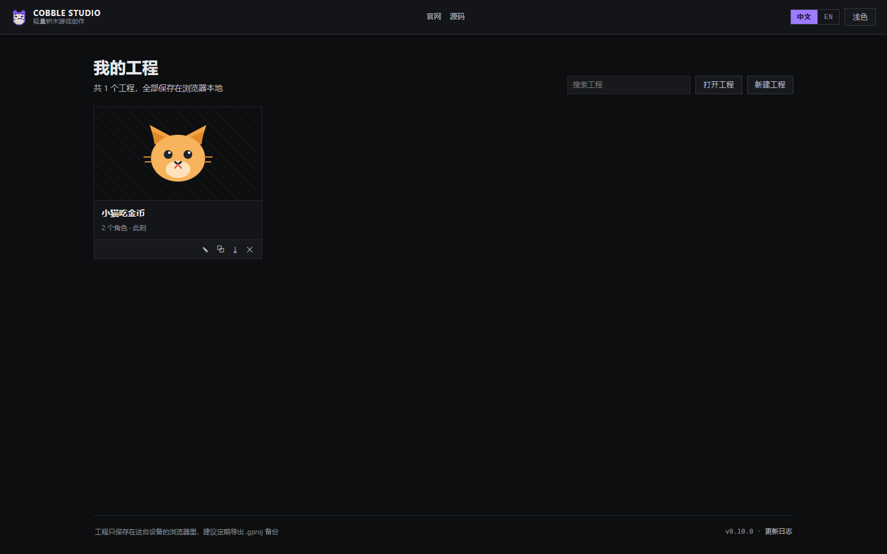
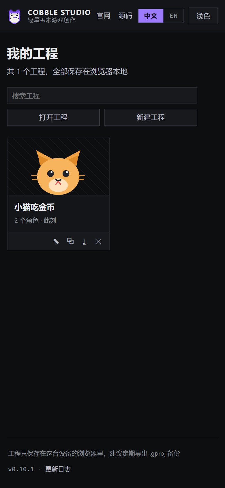
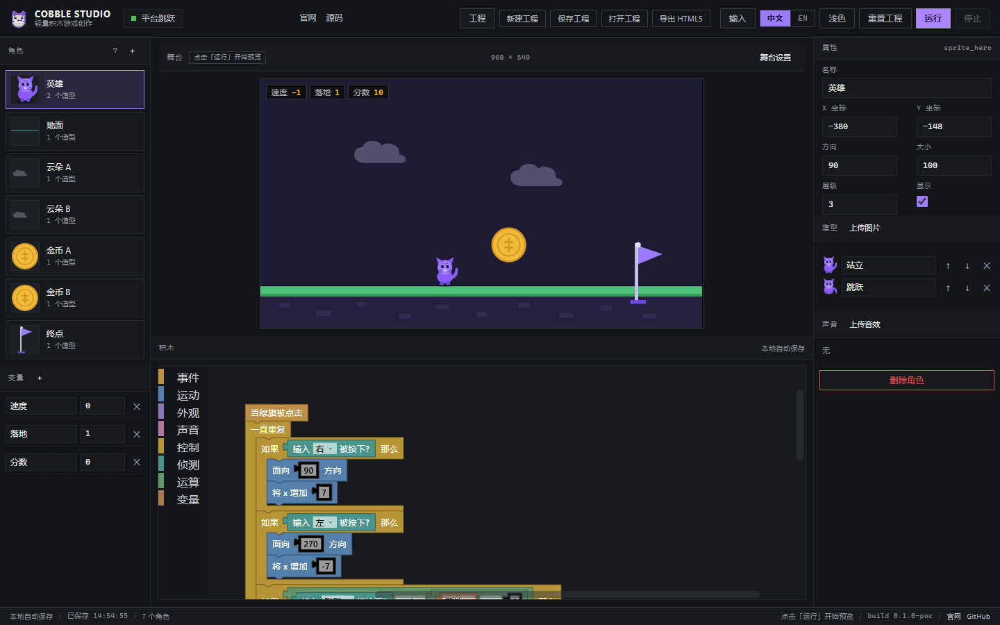
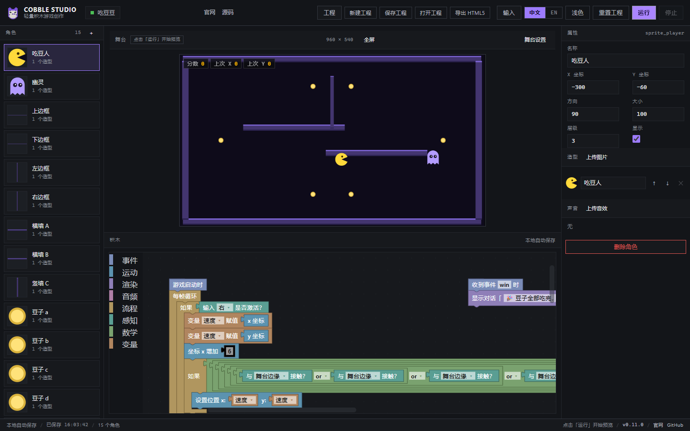

<p align="center"></p>

# Cobble Studio · 轻量 2D 积木游戏创作平台

用积木拼逻辑，一键运行 2D 小游戏。当前是 **P0 的可运行原型（M0）**：积木编辑 → 编译 IR → iframe 内 Phaser 运行时跑起来的完整链路已经打通，内置 8 个新建模板与 4 款完整示例游戏，支持深浅主题、中英双语界面，以及手机 / 平板的触屏手柄；积木是低饱和、直角、方正的外观。

**交流群：[QQ 群 424124959](mqqapi://card/show_pslcard?src_type=internal&version=1&uin=424124959&card_type=group&source=qrcode)（点击直接加群）· 抖音群 888985597118** —— 版本更新、教程与答疑

**[官网](https://ongikan.github.io/cobble/)** · **[在线演示（稳定版）](https://ongikan.github.io/cobble/demo/)** · **[测试版在线演示](https://ongikan.github.io/cobble/demo-beta/)** · **[GitHub 仓库](https://github.com/ONGIKAN/cobble)**


| 桌面（深色） | 手机（390×844） |
| --- | --- |
|  |  |

| 工程管理页（启动首页） | 手机上的工程管理页 |
| --- | --- |
|  |  |

| 手机积木页 | 运行中（分数 +2） |
| --- | --- |
|  |  |

| 平台跳跃 v2 | 吃豆豆 |
| --- | --- |
|  |  |

## 下载安装包

稳定版 v0.12.0 的安装包通过 GitHub Releases 分发（官方下载入口：<https://ongikan.github.io/cobble/#download>）：

| 平台 | 文件 | 说明 |
| --- | --- | --- |
| Windows | [`CobbleStudio-Windows-x64-Setup.exe`](https://github.com/ONGIKAN/cobble/releases/latest/download/CobbleStudio-Windows-x64-Setup.exe) | Tauri NSIS 安装版，装到当前用户，约 1.9 MB |
| Windows | [`CobbleStudio-Windows-x64-Portable.exe`](https://github.com/ONGIKAN/cobble/releases/latest/download/CobbleStudio-Windows-x64-Portable.exe) | 免安装便携版，约 3.7 MB，需放纯英文路径 |
| Android | [`CobbleStudio-Android.apk`](https://github.com/ONGIKAN/cobble/releases/latest/download/CobbleStudio-Android.apk) | Capacitor APK，debug 签名，Android 6.0+，约 5.1 MB |

> 安装包未做代码签名；Windows 首次运行可能出现 SmartScreen 提示（更多信息 → 仍要运行），安卓安装需允许未知来源。桌面版工程以 `.gproj` 落盘到 `%APPDATA%/studio.cobble.app/projects`。

## 快速开始

```bash
git clone https://github.com/ONGIKAN/cobble.git
cd cobble
npm install
npm run dev          # 打开 http://127.0.0.1:5183
```

打开后会自动载入示例工程「小猫吃金币」：

- 点右上角 **运行** 或直接按方向键，小猫会左右上下移动，碰到金币分数 +1，金币随机换位置
- 舞台下方是触屏手柄：左侧摇杆控制方向，右侧按钮触发绑定的输入事件；全屏时手柄浮在下缘，手机上按住摇杆即可移动
- 每个工程可以单独配置触屏交互（「输入」设置）：手柄模式（摇杆 + 自定义按钮，三档尺寸）或**直接触摸模式**（不显示手柄，点按角色互动、按住拖动角色）；也能自定义输入事件绑定的按键
- **停止** 结束运行；**中文 / EN** 切换界面语言（会整页重载）；**浅色 / 深色** 切换主题
- 顶栏 **保存工程 / 打开工程**：下载 `.gproj`（工程 + 各角色积木数据）或载入之前保存的文件；手机上入口在舞台页头部
- 所有修改自动保存到 localStorage；桌面版（Tauri）会同时写入 `<应用数据目录>/projects/<id>.gproj`，可直接备份或拷走
- 底栏显示当前版本号，点击版本号打开官网版本日志

其他命令：

```bash
npm run typecheck    # TypeScript 全量类型检查
npm run build        # 生产构建（输出 apps/editor/dist）
npm run preview      # 预览构建产物
npm run smoke        # 桌面冒烟测试（需要本机 Edge + dev server 已启动）
npm run smoke:mobile # 手机（390×844）/ 平板（820×1180）触屏冒烟测试
```

冒烟测试用 `playwright-core` 驱动本机 Microsoft Edge（`C:\Program Files (x86)\Microsoft\Edge\Application\msedge.exe`），会验证：编辑器加载、角色列表、积木渲染、iframe 运行、方向键移动、金币碰撞加分、停止清理、保存/打开 `.gproj`、主题切换、中英切换、控制台无报错，并把截图写到 `tools/shots/`；`smoke:mobile` 额外验证紧凑布局、底部标签页、屏幕方向键、角色快捷条、手机端工程文件入口与触屏交互。

## 桌面版（Tauri）

桌面端只用 **Tauri 2**（已移除 Electron 方案）：

```bash
npm run build                      # 先构建编辑器
./tools/build-tauri.bat build --release
# 产物：apps/desktop/src-tauri/target/release/cobble-studio.exe
```

- 前端通过自定义 `app://` 协议加载构建产物，避免 `file://` 下 ES module 被 CORS 拦
- Rust 侧提供 `list_projects` / `read_project` / `write_project` / `delete_project` / `projects_location` 命令，工程文件落在应用数据目录的 `projects/` 下（Windows 一般是 `%APPDATA%/studio.cobble.app/projects`）
- 桌面版启动时会把 localStorage 工程库与磁盘上的 `.gproj` 对齐；编辑器里每次自动保存也会同步写盘，工程管理页底部会显示该目录
- 需要 MSVC（Visual Studio Build Tools / Community）与 Rust 工具链；`tools/build-tauri.bat` 会自动 `call VsDevCmd`

### 安装包

```bash
node tools/pack-desktop.mjs    # 构建编辑器 + Tauri release + NSIS 安装包
# 产物：dist-release/Cobble Studio_<version>_x64-setup.exe
#      dist-release/CobbleStudio-<version>-portable.exe
```

- NSIS 安装包按当前用户安装（`currentUser`），装到 `%LOCALAPPDATA%` 下，语言支持简体中文与 English
- **便携 exe 请放在纯英文路径下运行**：WebView2 在含中文的目录里可能无法创建窗口（Tauri 的已知限制，安装包路径天然是 ASCII 所以没有这个问题）
- 安卓版：`apps/mobile` 是 Capacitor 壳，`npx cap sync android` 后在本机 Gradle 环境里 `gradlew.bat assembleDebug`，产物在 `android/app/build/outputs/apk/debug/app-debug.apk`

## 发布官网与演示

站点分三块，互相链接：

| 页面 | 地址 | 来源 |
| --- | --- | --- |
| 官网 | `https://ongikan.github.io/cobble/` | `site/` |
| 在线演示（稳定版） | `https://ongikan.github.io/cobble/demo/` | `apps/editor/dist`（`VITE_CHANNEL=stable`） |
| 测试版演示 | `https://ongikan.github.io/cobble/demo-beta/` | `apps/editor/dist`（`VITE_CHANNEL=beta`，界面带 BETA 标记） |
| 源码 | `https://github.com/ONGIKAN/cobble` | 本仓库 `main` 分支 |

发布通道约定：常规小更新先发到 `/demo-beta/`（只有在线体验，不打包桌面版与安卓版），确认无误后再把稳定版发到 `/demo/`。`publish-pages.mjs` 会连续构建两个通道并分别放到 `pages-dist/demo` 与 `pages-dist/demo-beta`。

```bash
node tools/publish-pages.mjs                    # 构建 + 组装 pages-dist，本地可先验证
node tools/serve.mjs --port 8133 --root pages-dist
node tools/e2e-pages.mjs                        # 验证官网/演示/互链（先启动上面的静态服务器）

GH_TOKEN=<你的 token> node tools/publish-pages.mjs --push   # 推送到 gh-pages 分支
```

演示页顶栏/状态栏、官网导航与页脚、仓库 README 三处都放了互相的链接，改动链接时同步 `apps/editor/src/links.ts`、`site/index.html` 与 README。

## 已实现（本次）

| 模块 | 内容 |
| --- | --- |
| `packages/project` | 工程数据模型（ProjectDoc）、IR 类型、zod 校验、示例工程「小猫吃金币」 |
| `packages/i18n` | i18next 初始化、中英文资源包、语言检测/持久化、整页切换 |
| `packages/blocks` | 57 种自定义积木（含输入事件、交互、换成指定造型、x/y/方向 reporter、等待直到、移到角色等能力块）、9 分类工具箱（事件 / 交互 / 运动 / 渲染 / 音频 / 流程 / 感知 / 数学 / 变量）、Blockly → IR 编译器 |
| `packages/runtime` | 引擎无关的积木解释器：每帧指令预算、固定 60Hz 逻辑帧、hat 事件、广播、碰撞、变量表 |
| `packages/engine-phaser` | Phaser 4 适配器：纹理预加载、Scratch 坐标系换算、朝向/翻转、说话气泡、键鼠输入 |
| `apps/editor` | 三栏编辑器：角色/变量栏、舞台（iframe 预览）、Blockly 工作区、属性检查器；工程管理页、模板、输入设置、全屏运行；深浅主题；自动保存 |
| `apps/desktop` | Tauri 2 桌面壳（不再使用 Electron）：内置构建产物，工程文件以 `.gproj` 保存在系统应用数据目录，自动保存并可直接备份 |
| 工程文件 | 顶栏「保存工程 / 打开工程」：`.gproj`（JSON，含工程与各角色 Blockly 工作区，素材内联为 data URL），打开后整页重载；手机入口在舞台页头部 |
| 单文件导出 | 顶栏「导出 HTML5」：把工程编译成运行时指令，连同 Phaser 播放器、素材一起内联成一个 `.html`，双击即玩、离线可用；打开后显示变量 HUD 与官网链接 |
| 素材与角色 | 新建/删除角色、上传图片造型（PNG/JPEG/WebP/GIF/SVG ≤2MB，可改名/排序/删除）、上传音效（MP3/WAV/OGG/WebM ≤5MB，可试听/改名/删除）、变量增删改名改值、舞台背景色与尺寸预设（960×540 / 1280×720 / 640×360） |
| 模板与新建工程 | 新建工程弹层：空白工程 + 小猫吃金币 / 打地鼠 / 接苹果 / 平台跳跃 / 吃豆豆 / 勇者小镇 / 横版格斗 七个可玩模板；选择后新建工程并进入编辑，脚本随模板一起生成 |
| 示例游戏与能力块 | v0.7.0 起补齐游戏常用能力：换成指定造型、x/y/方向上报、等待直到、移到某角色。内置 4 款完整示例：平台跳跃 v2（16 角色、多平台与上下移动平台、巡逻史莱姆、HP=3 受伤回起点、5 枚金币与药水、终点要求金币收集满）；吃豆豆（迷宫墙体碰撞、收豆、幽灵追捕、通关判定）；勇者小镇 RPG（四方向移动、NPC 对话、3 颗星星收集、史莱姆伤害与回城回血）；横版格斗（玩家 vs 对手、HP/对手 HP、贴近按动作键攻击并击退、KO 判定） |
| 触屏适配 | 窗口 ≤1119px 自动切换紧凑布局：底部 4 标签（舞台/积木/角色/属性）、舞台页触屏手柄（摇杆 + 自定义按钮 + 全屏悬浮）、角色快捷条；粗指针设备（pointer: coarse）才显示手柄。每个工程可单独配置触屏交互模式（手柄 / 直接触摸）与尺寸，设置随工程保存 |
| 交互积木 | 「交互」分类：当角色被拖动时、指针 X / 指针 Y、角色被拖动？、设置可拖动 开/关；配合直接触摸模式可做点按、拖拽类玩法 |
| 积木外观 | 自定义 `square` 渲染器（thrasos 派生）：圆角半径 0、字段边框为直角、事件积木顶部压平；低饱和 8 类配色 |
| 工程管理页 | 启动即进入工程库：多工程卡片（缩略图 / 角色数 / 脚本数 / 更新时间）、搜索、新建、`.gproj` 导入、重命名 / 复制 / 导出 / 删除；hash 路由 `#/projects` 与 `#/editor/<id>`，工程存 localStorage `cobble.library`（旧版单工程自动迁移） |
| 官网 | `site/`：落地页（中英切换、截图、路线图、快速开始），直角深色设计，与演示页/仓库互链 |

## 还没做（P0 后续 / P1）

- 安装包签名与自动更新（当前是未签名安装包；Windows 首次运行会有 SmartScreen 提示）
- 精确像素级碰撞（目前是 AABB 矩形近似）
- 预览 iframe 的 sandbox 隔离（导出文件本身已是单文件，不依赖 iframe）
- RPG 战斗系统与吃豆豆多关卡等示例游戏深化

## 工程结构

```
cobble/
├─ apps/editor/                # React + Vite 编辑器 + player.html（舞台运行时页面）
│  └─ src/
│     ├─ components/           # Topbar / SpriteRail / StageView / BlocksView / Inspector / StatusBar / MobileTabs / ProjectFileButtons
│     ├─ player/main.ts        # iframe 内：PhaserAdapter + Runtime
│     ├─ store.ts              # zustand：工程、选中角色、主题、自动保存
│     ├─ project-file.ts       # .gproj 序列化 / 解析 / 下载与读取
│     ├─ useCompact.ts         # 紧凑布局 / 粗指针（触屏）媒体查询
│     ├─ demo-scripts.ts       # 示例工程的积木脚本（程序化生成）
│     ├─ links.ts              # 官网 / 演示 / 仓库地址（三页互链）
│     └─ blockly-theme.ts      # 深/浅主题 + 自定义 square 直角渲染器
├─ packages/
│  ├─ project/                 # 数据模型 + IR + 示例工程
│  ├─ i18n/                    # 中英文资源 + i18next
│  ├─ blocks/                  # 积木定义、工具箱、编译器
│  ├─ runtime/                 # 积木解释器（引擎无关）
│  └─ engine-phaser/           # Phaser 4 适配层
├─ site/                       # 官网落地页（纯静态，发布到 Pages 根目录）
├─ tools/
│  ├─ e2e-smoke.mjs            # 桌面冒烟测试（playwright-core + Edge）
│  ├─ e2e-mobile.mjs           # 手机 / 平板触屏冒烟测试
│  ├─ e2e-pages.mjs            # 官网 + 演示 + 互链验证
│  ├─ publish-pages.mjs        # 组装 pages-dist 并推送 gh-pages
│  ├─ build-standalone.mjs     # 生成单文件导出模板（import 前先跑）
│  ├─ make-logo.py             # 生成 LOGO（svg/png/ico/安卓图标）
│  ├─ build-tauri.bat          # 在 MSVC 环境下构建 Tauri 壳
│  └─ serve.mjs                # 静态服务器（本地预览 Pages 产物）
├─ docs/技术方案-v1.md         # 技术方案 v1（架构、积木清单、路线图、成本）
└─ tsconfig.json               # 全仓库路径别名 @cobble/*
```

## 设计约束（已落地）

- **UI 与内容分层**：界面文案全部走 i18n key（禁止硬编码）；作品内的角色名/变量名属于"内容"，切语言不翻译、工程文件也不含界面文案。
- **无圆角、方正积木**：全局 `border-radius: 0`；Blockly 使用自定义 `square` 渲染器（`CORNER_RADIUS = 0`、`FIELD_BORDER_RECT_RADIUS = 0`、`START_HAT_HEIGHT/WIDTH = 0`），积木为直角矩形。
- **预览与导出一致**：舞台 iframe 里跑的就是 `packages/runtime` + `packages/engine-phaser`；单文件 HTML5 导出的播放器由 `src/standalone/main.ts` 单独打一个 IIFE 包（`npm run build:standalone`），再内联进模板，保证"编辑时怎么玩，导出后就怎么玩"。
- **固定逻辑帧**：模拟按 60Hz 固定步长推进，与显示器刷新率无关。
- **相对路径发布**：编辑器与演示构建使用 `base: './'`，可直接放在 Pages 的 `/demo/` 子路径下运行。

## 已知限制

- 工程库只保存在当前浏览器的 localStorage：换设备、换浏览器或清缓存会丢失，重要作品请导出 `.gproj` 备份。

- 积木区首次加载会自动缩放并回到脚本顶部；脚本很长时需要滚动查看。
- 触屏布局是单栏切换式（同一时刻只显示舞台或积木），不是分栏；横屏手机会比竖屏更接近桌面布局。
- 自动保存只保存在本浏览器（同一 profile 的 localStorage），清缓存会丢；长期保存请用「保存工程」导出 `.gproj`。
- `.gproj` 是 JSON，素材以 data URL 内联，素材多时文件会偏大（后续会做素材引用/压缩）。
- 中文/英文切换会整页重载（Blockly 的语言包不支持热替换）。
- 便携版 exe 需放在纯英文路径下运行（WebView2 中文路径限制），正式安装包不受影响。

## 下一步（建议）

1. 稳定版收尾（v1.0.0）：示例游戏深化（RPG 战斗、吃豆豆多关卡）+ 编辑器体验打磨
2. 安装包签名与自动更新，安卓版打包成正式 APK
3. 精确像素级碰撞与更多积木（克隆、列表、自定义积木）
4. 账号与云端保存、作品社区（远期）

技术方案与完整路线图见 [docs/技术方案-v1.md](docs/技术方案-v1.md)。

## License

Apache License 2.0，见 [LICENSE](./LICENSE)。
