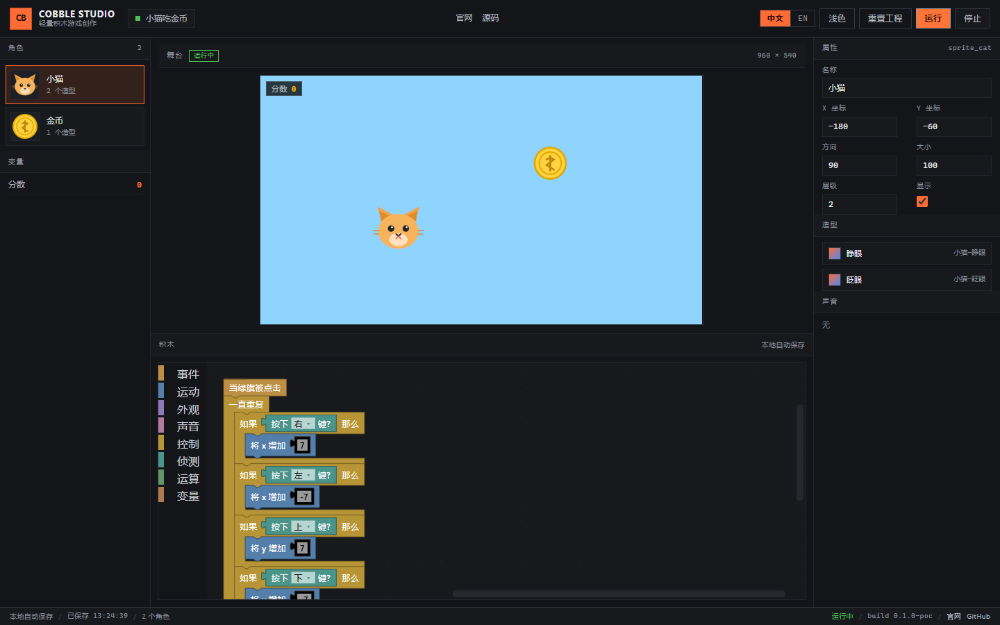
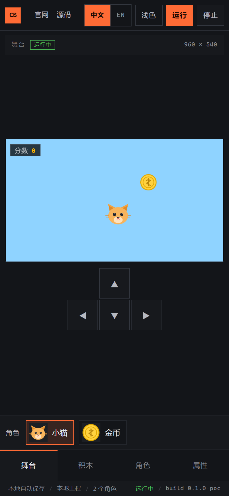
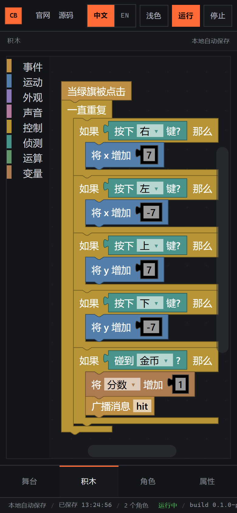
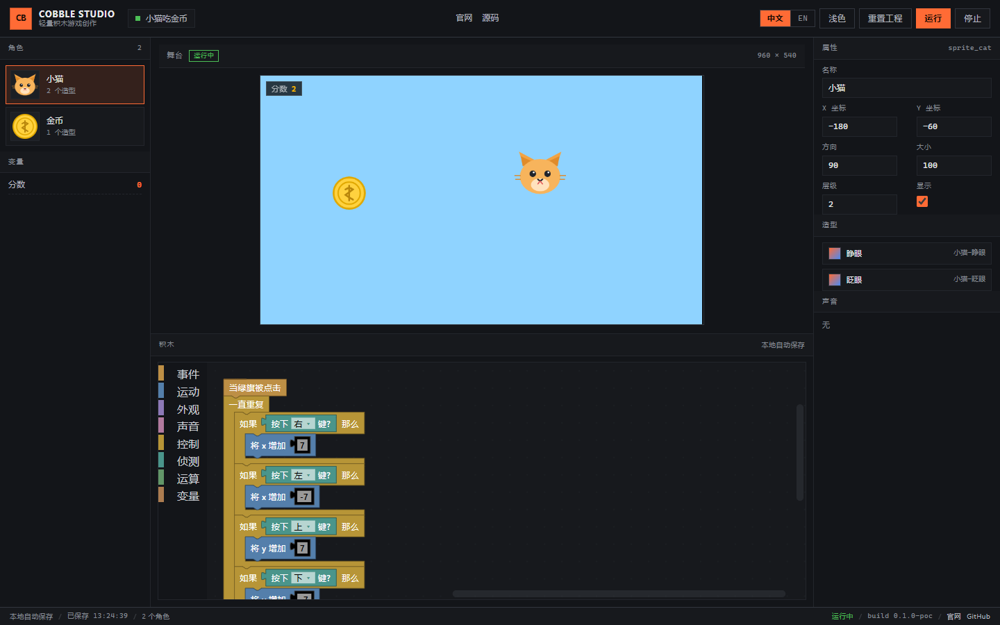

# Cobble Studio · 轻量 2D 积木游戏创作平台

用积木拼逻辑，一键运行 2D 小游戏。当前是 **P0 的可运行原型（M0）**：积木编辑 → 编译 IR → iframe 内 Phaser 运行时跑起来的完整链路已经打通，支持深浅主题、中英双语界面，以及手机 / 平板的触屏布局；积木是低饱和、直角、方正的外观。

**[官网](https://ongikan.github.io/cobble/)** · **[在线演示](https://ongikan.github.io/cobble/demo/)** · **[GitHub 仓库](https://github.com/ONGIKAN/cobble)**



| 桌面（深色） | 手机（390×844） |
| --- | --- |
|  |  |

| 手机积木页 | 运行中（分数 +2） |
| --- | --- |
|  |  |

## 快速开始

```bash
git clone https://github.com/ONGIKAN/cobble.git
cd cobble
npm install
npm run dev          # 打开 http://127.0.0.1:5183
```

打开后会自动载入示例工程「小猫吃金币」：

- 点右上角 **运行** 或直接按方向键，小猫会左右上下移动，碰到金币分数 +1，金币随机换位置
- **停止** 结束运行；**中文 / EN** 切换界面语言（会整页重载）；**浅色 / 深色** 切换主题
- 所有修改自动保存到 localStorage（`cobble.autosave`），刷新页面不会丢

其他命令：

```bash
npm run typecheck    # TypeScript 全量类型检查
npm run build        # 生产构建（输出 apps/editor/dist）
npm run preview      # 预览构建产物
npm run smoke        # 桌面冒烟测试（需要本机 Edge + dev server 已启动）
npm run smoke:mobile # 手机（390×844）/ 平板（820×1180）触屏冒烟测试
```

冒烟测试用 `playwright-core` 驱动本机 Microsoft Edge（`C:\Program Files (x86)\Microsoft\Edge\Application\msedge.exe`），会验证：编辑器加载、角色列表、积木渲染、iframe 运行、方向键移动、金币碰撞加分、停止清理、主题切换、中英切换、控制台无报错，并把截图写到 `tools/shots/`；`smoke:mobile` 额外验证紧凑布局、底部标签页、屏幕方向键、角色快捷条与触屏交互。

## 发布官网与演示

站点分三块，互相链接：

| 页面 | 地址 | 来源 |
| --- | --- | --- |
| 官网 | `https://ongikan.github.io/cobble/` | `site/` |
| 在线演示 | `https://ongikan.github.io/cobble/demo/` | `apps/editor/dist` 构建产物 |
| 源码 | `https://github.com/ONGIKAN/cobble` | 本仓库 `main` 分支 |

```bash
node tools/publish-pages.mjs                    # 构建 + 组装 pages-dist，本地可先验证
node tools/serve.mjs --port 8133 --root pages-dist
node tools/e2e-pages.mjs                        # 验证官网/演示/互链（先启动上面的静态服务器）

GH_TOKEN=<你的 token> node tools/publish-pages.mjs --push   # 推送到 gh-pages 分支
```

演示页顶栏/状态栏、官网导航与页脚、仓库 README 三处都放了互相的链接，改动链接时同步 `apps/editor/src/links.ts`、`site/index.html` 与 README。

## 已实现（本次）

| 模块 | 内容 |
| --- | --- |
| `packages/project` | 工程数据模型（ProjectDoc）、IR 类型、zod 校验、示例工程「小猫吃金币」 |
| `packages/i18n` | i18next 初始化、中英文资源包、语言检测/持久化、整页切换 |
| `packages/blocks` | 43 种自定义积木（事件 5 / 运动 10 / 外观 6 / 声音 3 / 控制 6 / 侦测 4 / 运算 6 / 变量 3）、8 分类工具箱、Blockly → IR 编译器 |
| `packages/runtime` | 引擎无关的积木解释器：每帧指令预算、固定 60Hz 逻辑帧、hat 事件、广播、碰撞、变量表 |
| `packages/engine-phaser` | Phaser 4 适配器：纹理预加载、Scratch 坐标系换算、朝向/翻转、说话气泡、键鼠输入 |
| `apps/editor` | 三栏编辑器：角色/变量栏、舞台（iframe 预览）、Blockly 工作区、属性检查器；深浅主题；自动保存；运行/停止 |
| 触屏适配 | 窗口 ≤1119px 自动切换紧凑布局：底部 4 标签（舞台/积木/角色/属性）、舞台页屏幕方向键、角色快捷条；粗指针设备（pointer: coarse）才显示方向键 |
| 积木外观 | 自定义 `square` 渲染器（thrasos 派生）：圆角半径 0、字段边框为直角、事件积木顶部压平；低饱和 8 类配色 |
| 官网 | `site/`：落地页（中英切换、截图、路线图、快速开始），直角深色设计，与演示页/仓库互链 |

## 还没做（P0 后续 / P1）

- 工程文件的新建、保存/打开、`.gproj` 导入导出（目前只有 localStorage 自动保存）
- 角色/造型/声音的增删、素材上传（示例工程的素材是内联 SVG）
- 单文件 HTML5 导出（把 runtime + 工程一起打包成双击可玩的 html）
- 声音试听与示例音效（声音块已编译，示例工程暂无音频素材）
- 精确像素级碰撞（目前是 AABB 矩形近似）
- 预览 iframe 的 sandbox 隔离（需先改成 IIFE 构建，P1）
- Tauri 2 桌面壳（P2）

## 工程结构

```
cobble/
├─ apps/editor/                # React + Vite 编辑器 + player.html（舞台运行时页面）
│  └─ src/
│     ├─ components/           # Topbar / SpriteRail / StageView / BlocksView / Inspector / StatusBar / MobileTabs
│     ├─ player/main.ts        # iframe 内：PhaserAdapter + Runtime
│     ├─ store.ts              # zustand：工程、选中角色、主题、自动保存
│     ├─ useCompact.ts         # 紧凑布局 / 粗指针（触屏）媒体查询
│     ├─ demo-scripts.ts       # 示例工程的积木脚本（程序化生成）
│     ├─ links.ts              # 官网 / 演示 / 仓库地址（三页互链）
│     └─ blockly-theme.ts      # 深/浅主题 + 自定义 square 直角渲染器
├─ packages/
│  ├─ project/                 # 数据模型 + IR + 示例工程
│  ├─ i18n/                    # 中英文资源 + i18next
│  ├─ blocks/                  # 积木定义、工具箱、编译器
│  ├─ runtime/                 # 积木解释器（引擎无关）
│  └─ engine-phaser/           # Phaser 4 适配层
├─ site/                       # 官网落地页（纯静态，发布到 Pages 根目录）
├─ tools/
│  ├─ e2e-smoke.mjs            # 桌面冒烟测试（playwright-core + Edge）
│  ├─ e2e-mobile.mjs           # 手机 / 平板触屏冒烟测试
│  ├─ e2e-pages.mjs            # 官网 + 演示 + 互链验证
│  ├─ publish-pages.mjs        # 组装 pages-dist 并推送 gh-pages
│  └─ serve.mjs                # 静态服务器（本地预览 Pages 产物）
├─ docs/技术方案-v1.md         # 技术方案 v1（架构、积木清单、路线图、成本）
└─ tsconfig.json               # 全仓库路径别名 @cobble/*
```

## 设计约束（已落地）

- **UI 与内容分层**：界面文案全部走 i18n key（禁止硬编码）；作品内的角色名/变量名属于"内容"，切语言不翻译、工程文件也不含界面文案。
- **无圆角、方正积木**：全局 `border-radius: 0`；Blockly 使用自定义 `square` 渲染器（`CORNER_RADIUS = 0`、`FIELD_BORDER_RECT_RADIUS = 0`、`START_HAT_HEIGHT/WIDTH = 0`），积木为直角矩形。
- **预览与未来导出一致**：舞台 iframe 里跑的就是 `packages/runtime` + `packages/engine-phaser`，之后单文件 HTML5 导出复用同一套运行时。
- **固定逻辑帧**：模拟按 60Hz 固定步长推进，与显示器刷新率无关。
- **相对路径发布**：编辑器与演示构建使用 `base: './'`，可直接放在 Pages 的 `/demo/` 子路径下运行。

## 已知限制

- 积木区首次加载会自动缩放并回到脚本顶部；脚本很长时需要滚动查看。
- 触屏布局是单栏切换式（同一时刻只显示舞台或积木），不是分栏；横屏手机会比竖屏更接近桌面布局。
- 自动保存只保存在本浏览器（同一 profile 的 localStorage），清缓存会丢。
- 中文/英文切换会整页重载（Blockly 的语言包不支持热替换）。
- 示例工程只有一个角色脚本 + 一个金币脚本，用于演示链路，不是完整游戏模板。

## 下一步（建议）

1. 工程文件系统：新建/打开/保存 `.gproj`（FS Access API 或 Tauri 对话框）
2. 素材与角色管理：上传图片/音效、增删角色与造型
3. 单文件 HTML5 导出 + iframe sandbox 隔离
4. Tauri 2 桌面壳，直接打开本地工程文件
5. 用 Blockly 生成示例模板（打地鼠、接苹果等）并落到模板库

技术方案与完整路线图见 [docs/技术方案-v1.md](docs/技术方案-v1.md)。
